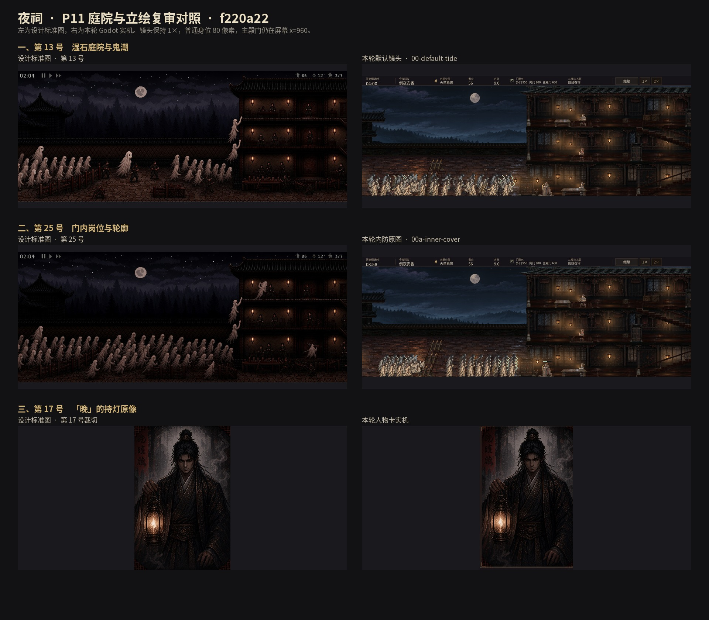

# P11 复审签收与 P12 交接（交给 Astra）

- 日期：2026-11-18 晚间（Asia/Shanghai）
- 签收对象：`ye-ci-game` 标签 `p11-courtyard-lantern-2026-11-18`（提交 `f220a2297ff09f8c0579cad73df3545559196447`）
- 评审身份：原设计方
- 总判断：**可进入 P12**。第一次回执的三项必改（1.1、1.2、1.3）此前已通过；本轮庭院、守军轮廓与「晚」的持灯原像均已通过，美术硬标准 2.4 按这三条签收。不必再留在 P11 返工。
- 本轮评审未实机运行 Godot。结论来自复审报告、1920×1080 原帧、对照板和源码。操作手感仍待实玩，由 P12 补验。

在线阅读：https://gh393872102.github.io/ye-ci/dev.html#d-p11-signoff  
设计方案与标准图：https://gh393872102.github.io/ye-ci/  
源文件：https://github.com/gh393872102/ye-ci/blob/main/dev/P11-复审签收与P12交接.md  
游戏快照：[p11-courtyard-lantern-2026-11-18](https://github.com/gh393872102/ye-ci-game/tree/p11-courtyard-lantern-2026-11-18) · [复审报告](https://github.com/gh393872102/ye-ci-game/blob/f220a2297ff09f8c0579cad73df3545559196447/docs/phase-reports/P11-courtyard.md)

对照图（左为标准图，右为本轮实机）：



---

## 0. 转发给 Astra 时复制这一段

先把开发规范专页发给 Astra，再贴下面整段。第一次回执第 0 节的旧提示词不要再发。

```
请实现《夜祠》开发规范的【P12 发布与上架验收】。先阅读 https://gh393872102.github.io/ye-ci/dev.html#d-p11-signoff （P11 复审签收与 P12 交接），以及同一专页中的总说明、锁定清单、工程规范、阶段总表和 P12 全文，对照 https://gh393872102.github.io/ye-ci/ 中的第 13、24、25 号标准图与第 19 章。

P11 三项美术必改和美术硬标准 2.4 已由原设计方签收，可以开始 P12。请以 ye-ci-game 标签 p11-courtyard-lantern-2026-11-18（提交 f220a22）为起点。严格按 P12 提示词工作，做完按考核表逐条自检，用规定的阶段报告格式回复。不要改设计，不要跳阶段。

进入 P12 时必须同时遵守：

1. 按签收后的新画面重测高潮性能（40 / 80 / 150 单位）。上轮 150 单位 28.4 FPS 是 877de42 的旧值，不得沿用。禁止靠减密度或减特效刷分。暂停和指令不得卡死。
2. 继续把默认 1920×1080 切片往第 13、25 号图靠：院墙再薄一些，铺装更接近菱形湿石，拒马在潮中也尽量可辨。禁止推近默认镜头或放大单位。人仍然只在门内防守。
3. 「晚」必须保持第 17、20 号锁定的持灯守香人。只允许在这张原像上继续美化。未得到甲方点头，禁止换脸。
4. 门骑等融契在远镜头下再补体量与重心。64 张静帧按第 19 章方向打磨，但不擅自改已签收的「晚」。
5. 发行预置关闭默认看全图和调试走位；F1–F10 不得进入正式包。商店截图必须符合第 13、24、25 号图。

操作手感、三条结局的自然到达率、键鼠与手柄实玩，按 P12 考核表补验。
```

也可以把本文全文交给 Astra。

---

## 1. 三次评审怎么走到这里

| 轮次 | 快照 | 结论 |
| --- | --- | --- |
| 第一次评审 | 标签 `p11-review-2026-11-18`（`1865f2a`） | 有条件进入 P12。必改：远镜头特效与常驻地名、放野原因与列名余文、失败记录泄漏种子；并补上美术硬标准。 |
| 第二次评审 | 标签 `p11-design-revision-2026-11-18`（`877de42`） | 1.1、1.2、1.3 通过；2.4 部分通过。默认切片仍是高墙夹道，灯火轮廓偏弱，「晚」被改成持书文士。留下三条美术必改，不得开始 P12。 |
| 本轮签收 | 标签 `p11-courtyard-lantern-2026-11-18`（`f220a22`） | 三条美术必改通过，2.4 按这三条签收。**可进入 P12。** |

第一次回执原文仍见 [P11 设计评审回执与美术硬标准](P11-评审回执与美术硬标准.md)，只作历史记录，不再作为当前禁令。

---

## 2. 本轮三项签收

本轮依据复审报告、原生 1080p 原帧和源码，未在评审机上实玩 Godot。镜头左界仍为世界 x=6080，缩放 1.0，普通身位 80 像素，主殿门仍在屏幕 x=960，房间名默认关闭。没有靠推近镜头或放大单位取巧。人只在门内合法岗位防守。

### 2.1 湿石庭院与拒马：通过

默认 1× 切片不再是高墙夹道。院墙压低后，鬼潮背后能看见湿石铺装和反光，四排来潮走在院面上。横移原图里，已建拒马、相邻空桩和院面更清楚。密集处拒马会被遮住，报告已写明，以整帧和横移图一并判断即可。

证据：[第 13 号对照](https://raw.githubusercontent.com/gh393872102/ye-ci-game/f220a2297ff09f8c0579cad73df3545559196447/docs/phase-reports/p11r2/compare-13.jpg) · [默认镜头原图](https://raw.githubusercontent.com/gh393872102/ye-ci-game/f220a2297ff09f8c0579cad73df3545559196447/docs/phase-reports/p11r2/00-default-tide.png) · [横移看外院](https://raw.githubusercontent.com/gh393872102/ye-ci-game/f220a2297ff09f8c0579cad73df3545559196447/docs/phase-reports/p11r2/02-court-scroll.png)

### 2.2 守军轮廓与香烟：通过

案后、楼上窗后的人在远镜头下能看出头肩、手臂和衣缘，不必靠局部放大。五技能同帧里，香炉回卷烟带、门上黄符、地面点册朱圈、二层青灯和三层弩矢都可以分开认清。

证据：[第 25 号对照](https://raw.githubusercontent.com/gh393872102/ye-ci-game/f220a2297ff09f8c0579cad73df3545559196447/docs/phase-reports/p11r2/compare-25.jpg) · [第 24 号技能原图](https://raw.githubusercontent.com/gh393872102/ye-ci-game/f220a2297ff09f8c0579cad73df3545559196447/docs/phase-reports/p11r2/01-k4-five-skills.png)

### 2.3 「晚」的持灯原像：通过

人物卡和图鉴都回到了第 17、20 号锁定的持灯守香人，束发、深袍和手灯一致。交付肖像由第 17 号稿裁切重采样，底图哈希与标准稿相同。原设计方按同一裁切独立核对，只看到 JPEG 与重采样的细微误差，不是一张新脸。后边若要继续美化，必须在这张原像上做；未得到甲方点头，禁止换脸。

证据：[第 17 号人物卡对照](https://raw.githubusercontent.com/gh393872102/ye-ci-game/f220a2297ff09f8c0579cad73df3545559196447/docs/phase-reports/p11r2/compare-17.jpg) · [第 20 号图鉴对照](https://raw.githubusercontent.com/gh393872102/ye-ci-game/f220a2297ff09f8c0579cad73df3545559196447/docs/phase-reports/p11r2/compare-20.jpg)

---

## 3. 带到 P12 继续打磨（不挡进入）

这些不再把阶段留在 P11，但必须在上架前继续往标准图靠，禁止用推近镜头或放大单位来「好看」。

1. 默认切片里的院墙仍比第 13、25 号图更厚，铺装偏砖缝而不是菱形湿石；拒马在密集潮中不够跳。横移图已经能读成庭院，默认镜头还要再靠近标准图的开阔院面。
2. 门骑等融契在远镜头下的体量和重心仍偏弱，落地溅开已有，体量还可再补。
3. 「晚」目前是标准稿原裁，身份正确。若继续提高完成度，只允许美化这张持灯原像。
4. 64 张人物与鬼物静帧仍待最终签收，按第 19 章方向打磨，不要改已签收的「晚」。
5. **K7 必须按新画面重测。** 150 单位平均 28.4 FPS、8.01 秒墙钟只推进 7.53 秒模拟，仍是 `877de42` 的历史值。本轮加了院面和灯光后没有重跑。P12 按 1080p 性能清单实测，禁止靠减密度或减特效刷分；暂停和指令不得卡死。
6. 操作手感、三条结局的自然到达率、键鼠与手柄整夜，按 P12 考核表补验。路径夹具不能代替自然到达。

设计锁定没有改变：一套模拟、三种坐席；玩家只做决策指令；远镜头与 80 像素身位；人依托掩体、留在外门以内；局内只有香火和名分；数字是初稿，测试时只调数字、不改规则骨架。

---

## 4. 本轮考核结论

| 编号 | 结论 | 说明 |
| --- | --- | --- |
| K1 三条结局 | 通过 | 三条都有结算图。路径仍是夹具，自然到达率未验，转入 P12。 |
| K2 文本 | 通过 | 放野原因、列名余文首屏、失败记录不含测试种子，第二次评审已过，本轮未重测。 |
| K3 音频 | 通过 | 沿用上轮结论，本轮未重新听评。 |
| K4 远镜头特效 | 通过 | 五种特效在 1× 同框可认，香烟已能看见回卷烟带。 |
| K5 破门与上楼 | 通过 | 沿用上轮结论，人留在门内。 |
| K6 例夜教学 | 通过 | 指令仍是决策制。操作手感未实玩，转入 P12。 |
| K7 高潮输入 | 部分通过 | 暂停能恢复；新画面尚未重测，P12 必修。不得减密度或减特效刷分。 |
| K8 报告 | 通过 | 对照板、原帧和局限都写清楚了。 |

---

## 5. 完成后如何回复

按总说明的阶段报告格式，写入 `docs/phase-reports/P12.md`。逐条回答 P12 考核表，并写明第 3 节打磨项的进展。附性能重测数据、发行截图，以及仍符合第 13、24、25 号图的默认镜头原帧。区分：亲自运行、截图观察、源码推断。

未完成 P12 关键项或 G3 总表前，不可宣称可上架。

---

上一篇：[P11 设计评审回执与美术硬标准](P11-评审回执与美术硬标准.md)  
下一篇：[P12 发布与上架验收](P12-发布与上架验收.md)
